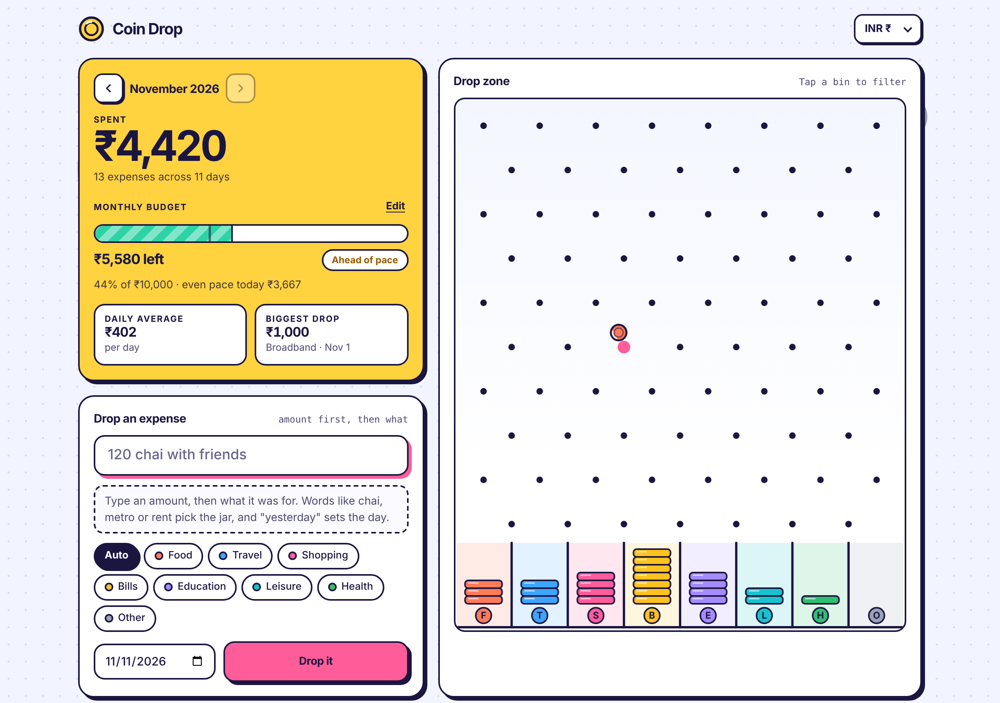
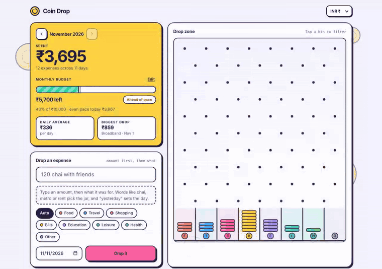
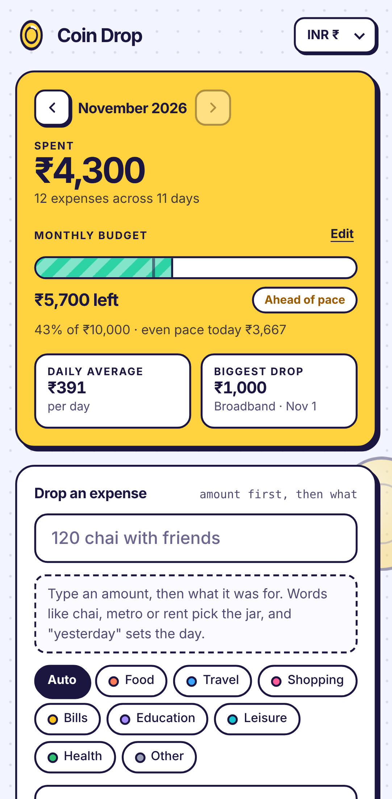
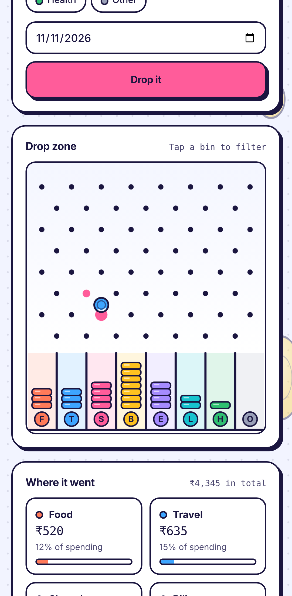

# Coin Drop

An expense tracker where every expense is a coin. Type `120 chai with friends`, press **Drop it**, and watch the coin bounce down a Plinko board into the Food bin.

**Live demo:** https://tambesujal406-design.github.io/coin-drop/

## What it does

- **One-line quick add.** Amount first, then what it was for. Words like chai, metro, rent or movie pick the category for you, and "yesterday" sets the date. A row of chips lets you override the category.
- **Plinko drop board.** Each expense becomes a coin that bounces down a peg board. The route is random, but the coin always lands in the right category bin. The stack in each bin shows that category's share of the month.
- **Budget meter.** A striped meter with a marker for where an even spending pace would be today, plus an "Under pace", "Ahead of pace" or "Over budget" label.
- **Jars.** Tap a jar, or a bin on the board, to filter the transaction list to that category.
- **Six-month chart.** Stacked bars split by category. Tap a month to open it.
- **Transactions.** Grouped by day, with delete and undo, and a button that copies everything as CSV.
- **Currencies and themes.** INR, USD, EUR and GBP. Light theme, works from phone to desktop, and respects the reduced-motion setting.

  
  

## Run it

It is a single file with no build step and no dependencies. Open `index.html` in a browser.

Fonts load from Google Fonts. Offline, the page falls back to system fonts.

Entries are saved in your browser (localStorage) on the device you use. A first visit shows example data until you add your first expense.

## Publish it with GitHub Pages

1. Push this folder to a GitHub repository.
2. Open **Settings**, then **Pages**, and choose **Deploy from a branch** with `main` and the `/ (root)` folder.
3. After a minute the site is live at `https://<your-username>.github.io/<repo-name>/`.

## About this project

Built with AI assistance. I directed the design and iterated on it until it felt right.

## How it works

- Plain HTML, CSS and JavaScript. The board is drawn on a `<canvas>`.
- **Coin paths.** The board has alternating rows of pegs, offset by half a bin. Each coin takes a random walk of half-bin steps, constrained so it finishes in the centre of its target bin. Pegs flash when a coin hits them.
- **Quick-add parser.** A regular expression finds the amount (supports currency symbols, commas and a `k` suffix). A keyword table maps the remaining words to a category.
- **Fonts.** Unbounded, DM Sans and DM Mono from Google Fonts (SIL Open Font License).
